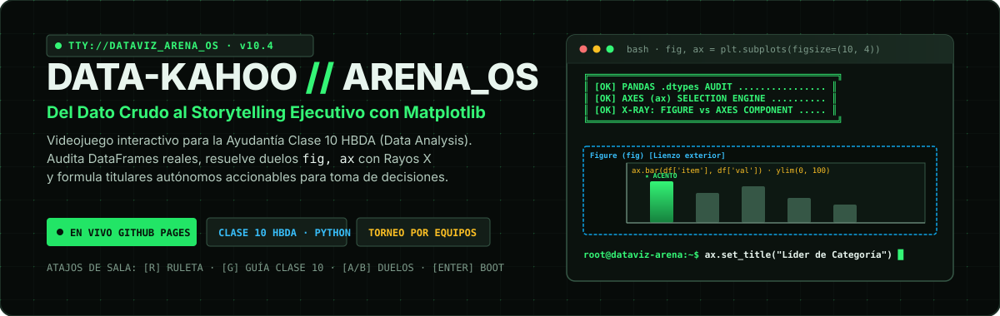
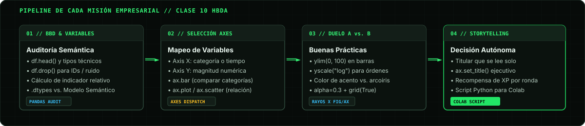

<p align="center">
  
</p>

<p align="center">
  <a href="https://nicogouet5.github.io/Data-Kahoo/"></a>
  
  
  
</p>

<h3 align="center">
  <a href="https://nicogouet5.github.io/Data-Kahoo/">▶ Iniciar Simulador en Vivo (GitHub Pages)</a> &nbsp;•&nbsp;
  <a href="#-flujo-de-misión-y-arquitectura-pedagógica">Pipeline Pedagógico</a> &nbsp;•&nbsp;
  <a href="#-atajos-de-teclado-en-sala-y-proyector">Atajos en Sala</a> &nbsp;•&nbsp;
  <a href="#-ejecución-local">Quickstart</a>
</h3>

---

## ⚡ ¿Qué es Data-Kahoo // ARENA_OS?

**Data-Kahoo** es un videojuego interactivo con estética de terminal hacker (`ARENA_OS v10.4`) creado para transformar la ayudantía de **Herramientas Básicas de Data Analysis (HBDA)** en una simulación de toma de decisiones visuales en tiempo real.

En lugar de memorizar sintaxis aislada, los estudiantes asumen el rol de operadores de inteligencia de datos ante sectores corporativos reales (gaming, retail omnicanal, finanzas fintech, streaming musical y movilidad urbana). En cada misión deben auditar la estructura semántica de los datos, mapear variables a los ejes de `Axes`, resolver duelos visuales A/B con malas prácticas reales de Matplotlib y redactar titulares de storytelling ejecutivo.

---

## 🗺 Flujo de Misión y Arquitectura Pedagógica

El juego desglosa el aprendizaje en un pipeline de **4 fases complementarias**, alineadas estrictamente con la **Clase 10 de HBDA**:

<p align="center">
  
</p>

### [01] BBD & Variables — Auditoría Semántica
- **Problema real:** Confundir los tipos técnicos de Python (`.dtypes` como `int64`, `float64`, `object`) con el verdadero **modelo semántico** del problema de negocio.
- **Mecánica:** Los estudiantes inspeccionan las columnas del dataset generado, identifican si las métricas brutas necesitan normalización porcentual (`%`) o cálculo de ratios, y purgan columnas de ruido o llaves primarias irrelevantes (`df.drop`).
- **Clasificación:** Cualitativa nominal / ordinal, cuantitativa discreta / continua y series de tiempo.

### [02] Selección de Ejes — Mapeo en `Axes (ax)`
- **Problema real:** Elegir gráficos al azar o forzar gráficos circulares (pie charts) con múltiples categorías.
- **Mecánica:** Se selecciona el gráfico objetivo según el tipo de variables de los ejes:
  - `ax.bar` / `ax.barh`: Comparación de categorías discretas u ordinales ordenadas por magnitud.
  - `ax.plot`: Evolución temporal continua (series de tiempo) con marcado de hitos.
  - `ax.scatter`: Correlación o dispersión multivariable con cuadrantes semánticos.
  - `ax.hist` / `ax.boxplot`: Distribución de frecuencia y detección de asimetrías o outliers.

### [03] Duelo A vs. B — Inspección con Rayos X (`fig` vs. `ax`)
- **Problema real:** Gráficos engañosos, ejes truncados, exceso de tinta no informativa (*chartjunk*) o leyendas que tapan puntos críticos.
- **Mecánica:** Dos salidas de Matplotlib (`BUILD_A` vs `BUILD_B`) compiten en pantalla. Los estudiantes activan el **Scanner Rayos X** para desglosar la jerarquía de Matplotlib:
  - **`Figure` (`fig`):** Lienzo general, resolución (`dpi`), dimensiones (`figsize=(10, 5)`), paleta de colores.
  - **`Axes` (`ax`):** El gráfico en sí, límites (`set_ylim`), escalas (`yscale('log')`), transparencia (`alpha=0.3`), rejilla sutil (`grid(True, alpha=0.3)`).
  - **`Axis` (`xaxis`/`yaxis`):** Formateo de ticks, rotación de etiquetas y nombres con unidades de medida.

### [04] Storytelling Ejecutivo & Script Colab
- **Problema real:** Dejar que la audiencia adivine la conclusión del gráfico mediante títulos descriptivos pasivos (e.g. *"Ventas vs. Tiempo"*).
- **Mecánica:** Redacción de titulares accionables que responden directamente a la pregunta de negocio (e.g. *"El 68% de las transacciones fraudulentas ocurren entre las 02:00 y las 05:00 hrs"*).
- **Exportación:** Generador de código Python / Matplotlib documentado con un clic para copiar y pegar directamente en Google Colab o Jupyter Notebooks.

---

## 🎮 Interfaz Hacker & Sistema de Audio

Diseñado con los estándares de **UI/UX Pro Max** y animaciones web modernas:

| Característica | Detalle Técnico | Beneficio en Aula |
| :--- | :--- | :--- |
| **Boot Hero ASCII Art** | Pantalla de bienvenida con telemetría de módulos, bloques ASCII y monitor interactivo de `fig, ax`. | Genera inmersión instantánea al proyectar en clase. |
| **View Transitions & Motion** | Transiciones espaciales `@starting-style` y cascadas escalonadas entre fases de misión. | Mantiene el contexto espacial sin saltos abruptos. |
| **Audio Sintético Retro** | Sintetizador de pulsos con `Web Audio API` (sin archivos MP3 externos). | Feedback auditivo inmediato al acertar o fallar (desactivable con un clic). |
| **Modo Dual Proyector** | Alternancia instantánea entre **Obsidiana Fósforo** y **Proyector Claro**. | Alto contraste garantizado tanto en monitores personales como en telones de salas docentes. |

---

## ⌨️ Atajos de Teclado en Sala y Proyector

Para dinámicas ágiles y participativas durante la clase, el simulador se puede controlar completamente desde el teclado:

- <kbd>Enter</kbd> / <kbd>Esc</kbd> — Entrar o saltar la secuencia Hero ASCII de arranque.
- <kbd>R</kbd> — Sortear una misión aleatoria entre los sectores disponibles.
- <kbd>G</kbd> — Desplegar / ocultar el **Manual de Campo (Cheat-Sheet Clase 10)**.
- <kbd>A</kbd> / <kbd>B</kbd> — Votar o seleccionar rápidamente `BUILD_A` o `BUILD_B` en el duelo visual.
- Botón **`>_`** (Header) — Reiniciar el arranque ASCII en cualquier momento de la presentación.

---

## 🚀 Ejecución Local

### Prerrequisitos
- Node.js 18+ (recomendado Node 20+)
- npm o pnpm

### Pasos rápidos

```bash
# 1. Clonar el repositorio
git clone https://github.com/nicogouet5/Data-Kahoo.git
cd Data-Kahoo

# 2. Instalar dependencias
npm install

# 3. Iniciar el servidor de desarrollo
npm run dev
```

Abre tu navegador en `http://localhost:5173/` (o la URL indicada por Vite).

### Servidor API Opcional (Express)

Si deseas utilizar el endpoint backend para generación procedural de misiones:

```bash
npm run server
```
El servidor backend escuchará en el puerto `3001` (`http://localhost:3001`).

---

## 🛠 Stack Tecnológico

- **Frontend:** React 19, Vite, Tailwind CSS v4, Lucide React, Canvas Confetti.
- **Audio Engine:** Web Audio API nativo con osciladores sinusoidales y de onda cuadrada.
- **Animaciones:** View Transitions API, CSS `@starting-style`, Canvas 2D.
- **Backend / Microservicio:** Node.js, Express, CORS.
- **Despliegue Continuo:** GitHub Actions & GitHub Pages (`gh-pages`).

---

<p align="center">
  <b>Herramientas Básicas de Data Analysis (HBDA)</b> • Material Pedagógico de Ayudantía<br>
  Desarrollado para la comunidad de estudiantes de ingeniería y ciencia de datos.
</p>
